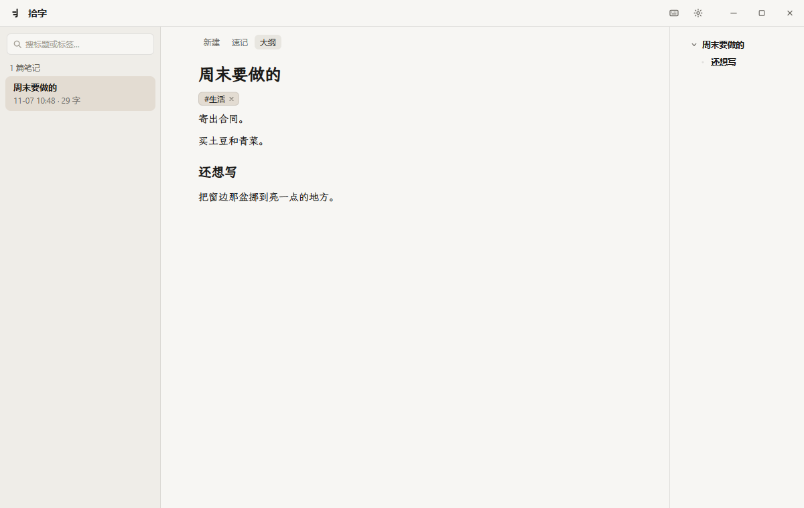
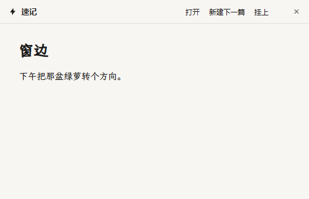
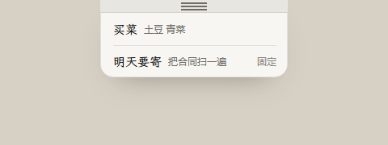

# 拾字

拾字是一款 Windows 本地 Markdown 笔记。打开就能写，停下自动保存。笔记是明文 `.md`，存在你自己的电脑上。

## 下载

到 [Releases](https://github.com/FishSwimmgingInTheSea/shizi/releases/latest) 下载最新的安装包，双击安装。文件名里带 `setup.exe`。

已经装过的会自己检查更新，打开时如果有新版本就会换上。

安装时如果 Windows 提示「已保护你的电脑」，点「更多信息」，再选「仍要运行」。

- Windows 10 1809+ 或 Windows 11（64 位）
- 需要 [WebView2](https://developer.microsoft.com/microsoft-edge/webview2/)。Windows 11 已自带

## 界面

主窗口。左侧是笔记列表，中间写作，右侧是大纲。

速记小窗。在任何地方按 ``Ctrl+` `` 唤起，窗口会留在最前面。

贴在屏幕边上的纸条。鼠标碰到所贴的那条边时展开。

## 怎么用

- 停止输入大约 1 秒后自动保存，`Ctrl+S` 会立刻保存
- 每篇笔记最多 8 个标签，列表可以按标签筛选
- 速记可以新写，也可以打开已有笔记。主窗口和速记同时看着同一篇时，停下来的那一边会跟上刚写的内容
- 在速记里点「挂上」，这篇会贴到屏幕边上，最多八篇。按住贴边的三道折痕，可以拖到另一边。点一条就在速记里打开。点「固定」后，鼠标离开也不收起。点「移除」只是从边上拿下，笔记还在
- 设置和托盘菜单里都可以关掉「贴边速记」。关掉之后，速记里不再显示「挂上」
- 主窗口点关闭后留在系统托盘，不退出
- 删除的笔记进回收站，可以还原
- 可以换浅色、深色或跟随系统，正文字号 12–20px，也可以关掉大纲
- 粘贴或拖入的图片保存在笔记旁边。支持 png、jpg、gif、webp、bmp，单张不超过 20MB

## 快捷键

| 快捷键 | 作用 |
| --- | --- |
| `Ctrl+N` | 新建笔记 |
| `Ctrl+S` | 立即保存 |
| ``Ctrl+` `` | 唤起速记小窗 |
| `Ctrl+W` | 保存后隐藏窗口 |
| `Esc` | 关闭设置或快捷键表；在速记小窗里，先关掉笔记列表，否则保存并收起 |

写正文时的标题、加粗、列表等，在窗口里点「快捷键」可以查看。行内代码用 `Ctrl+E`。

## 笔记放在哪

默认在 `%APPDATA%\com.notelet.app\notes\`。在设置里可以换文件夹。换的时候，已经写好的笔记和图片会一起搬过去。

这些文件可以用别的编辑器直接打开。把整个文件夹拷走，就是一份完整备份。
